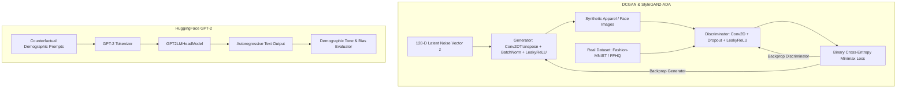

<div align="center">


[](https://www.python.org/)
[](https://www.tensorflow.org/)
[](https://pytorch.org/)
[](https://huggingface.co/)
[](https://jupyter.org/)
[](#)

</div>

---

## 📌 Executive Summary / Overview

The **AI Generative & Deep Learning Suite** represents an advanced portfolio of computational intelligence research, generative adversarial modeling, and large language model auditing. The codebase spans foundational discriminative classifiers, deep generative computer vision systems, and algorithmic fairness diagnostics across five structured laboratory investigations:

1. **Discriminative Binary Classification**: Pixel feature flattening and logistic regression modeling on filtered MNIST digits (0 vs 1).
2. **Autoregressive Text Generation with GPT-2**: PyTorch implementation leveraging Hugging Face's `GPT2LMHeadModel` and `GPT2Tokenizer` for greedy and top-k conditional text decoding.
3. **Algorithmic Bias Auditing in LLMs**: Empirical evaluation of gender and demographic skew across prompt completions generated by pretrained GPT-2 pipelines.
4. **StyleGAN2-ADA High-Fidelity Synthesis**: NVIDIA's adaptive discriminator augmentation architecture applied to the FFHQ face dataset, exploring latent vector truncation ($\psi$) and manifold interpolation.
5. **Deep Convolutional GAN (DCGAN) on Fashion-MNIST**: Full end-to-end generator and discriminator training pipeline with transposed convolutions, batch normalization, and LeakyReLU activations.

---

## 📖 Interactive Table of Contents

- [Executive Summary / Overview](#-executive-summary--overview)
- [Key Features & Capabilities](#-key-features--capabilities)
- [System Architecture & Pipeline](#-system-architecture--pipeline)
- [Tech Stack Breakdown](#-tech-stack-breakdown)
- [Module Breakdown & Notebooks](#-module-breakdown--notebooks)
- [Reproducible Quickstart & Setup](#-reproducible-quickstart--setup)
- [Project Directory Layout](#-project-directory-layout)
- [Author & Contributions](#-author--contributions)

---

## ✨ Key Features & Capabilities

- **DCGAN Synthetic Image Generation**: Synthesizes 28×28 grayscale apparel images from 128-dimensional latent Gaussian noise using alternating mini-batch gradient updates.
- **Latent Manifold Exploration with StyleGAN2-ADA**: Samples synthetic human portraits from NVIDIA FFHQ checkpoints, demonstrating truncation trick dynamics to balance fidelity against diversity.
- **Transformer NLP Evaluation**: Deploys pretrained GPT-2 models for open-ended text completion with controlled sampling parameters.
- **Demographic Bias Benchmarking**: Audits transformer prompt completions across occupation and social contexts to quantify stereotypical associations.
- **Linear Feature Disentanglement**: Analyzes high-dimensional 784-feature pixel arrays through binary decision boundaries with Scikit-Learn.

---

## 🏗️ System Architecture & Pipeline



---

## 🛠️ Tech Stack Breakdown

| Category | Technologies & Tools |
| :--- | :--- |
| **Language** | Python 3.9+ |
| **Deep Learning Frameworks** | TensorFlow 2.x, PyTorch 2.x, Keras |
| **Generative Vision** | StyleGAN2-ADA (PyTorch), DCGAN (TensorFlow/Keras) |
| **NLP & LLM** | Hugging Face Transformers (`gpt2`, `distilgpt2`), PyTorch LM Heads |
| **Scientific Computing** | NumPy, SciPy, Scikit-Learn |
| **Visualization & Data** | Matplotlib, PIL, ImageIO, Pandas |

---

## 🔬 Module Breakdown & Notebooks

| Notebook File | Focus Area | Core Architecture / Model | Key Libraries |
| :--- | :--- | :--- | :--- |
| `DCGAN_Fashion_MNIST_TensorFlow_Colab (1).ipynb` | Computer Vision | Deep Convolutional GAN | TensorFlow, Keras, Matplotlib |
| `Assignment_5.ipynb` | Generative Synthesis | StyleGAN2-ADA (FFHQ Checkpoint) | PyTorch, CUDA, ImageIO, PIL |
| `Asgnmt 3.ipynb` | NLP Fairness | Generative Bias Audit | Hugging Face Transformers, Pandas |
| `Asgmnt 2 AI.ipynb` | Language Modeling | Autoregressive Text Generation | PyTorch, GPT-2 LM Head |
| `Asgmnt 1 AI.ipynb` | Machine Learning | MNIST Binary Classification (0 vs 1) | Scikit-Learn, NumPy, Matplotlib |

---

## 🚀 Reproducible Quickstart & Setup

### Prerequisites
- Python 3.9+ with CUDA toolkit (recommended for GPU-accelerated GAN training)
- Jupyter Lab or Google Colab

### Installation
```bash
# Clone the repository
git clone https://github.com/Jeshwanthika07/AI_Assignment-1.git
cd AI_Assignment-1

# Create and activate virtual environment
python -m venv venv
# On Windows:
.\venv\Scripts\activate
# On Linux/macOS:
source venv/bin/activate

# Install required dependencies
pip install tensorflow torch torchvision transformers pandas numpy matplotlib scikit-learn pillow imageio
```

### Running the Notebooks
```bash
jupyter lab
```
Select any notebook (e.g., `DCGAN_Fashion_MNIST_TensorFlow_Colab (1).ipynb`) and execute all cells sequentially.

---

## 📂 Project Directory Layout

```text
AI_Assignment-1/
│
├── DCGAN_Fashion_MNIST_TensorFlow_Colab (1).ipynb  # DCGAN synthesis on Fashion-MNIST
├── Assignment_5.ipynb                             # StyleGAN2-ADA FFHQ latent synthesis
├── Asgnmt 3.ipynb                                 # Pretrained GPT-2 demographic bias audit
├── Asgmnt 2 AI.ipynb                              # GPT-2 tokenization & text generation
├── Asgmnt 1 AI.ipynb                              # MNIST 0/1 binary classification baseline
└── README.md                                      # Comprehensive research documentation
```

---

## 👩‍💻 Author & Contributions

Authored and maintained by **[Jeshwanthika Pothamchetty](https://github.com/Jeshwanthika07)**  
*Alliance University, Department of Computer Applications*

<div align="center">


</div>
